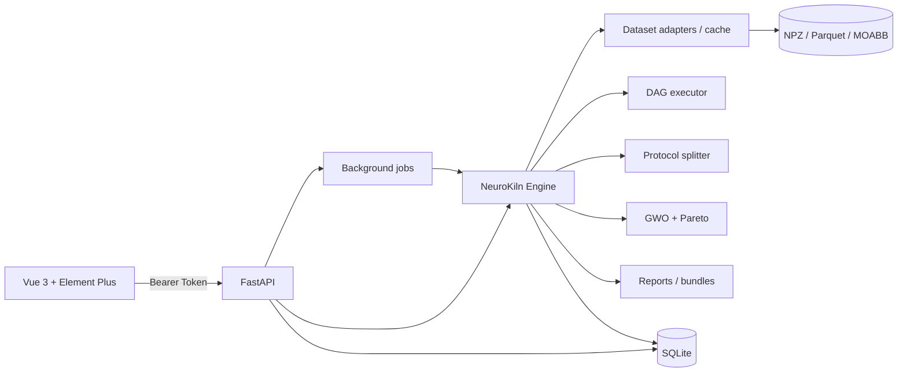

<p align="center">
  
</p>

<p align="center">
  <b>Reproducible, leakage-safe BCI algorithm evaluation and tuning</b><br>
  Datasets, protocols, DAG pipelines, metrics, reports and reproduction bundles in one auditable workflow.
</p>

<p align="center">
  
  
  
  
</p>

<p align="center">
  <a href="https://github.com/JadueW/neurokiln/actions/workflows/ci.yml"></a>
  <a href="https://github.com/JadueW/neurokiln/releases"></a>
  <a href="https://jaduew.github.io/neurokiln/"></a>
</p>

<p align="center">
  <a href="README.md">中文</a> · <a href="https://jaduew.github.io/neurokiln/">Documentation</a> · <a href="docs/user-manual.md">Manual</a> · <a href="docs/online-closed-loop.md">Online / closed loop</a> · <a href="docs/security.md">Security model</a>
</p>

---

## Why NeuroKiln

BCI research has three recurring failure modes:

1. **Leakage**: preprocessors are fitted on all data, CSP sees the test fold, or HPO selects candidates on the test set.
2. **Incomparable results**: different scripts, splits and seeds end up in the same table.
3. **Irreproducible papers**: "CSP + LDA" without bands, channels, regularization, early stopping or split details.

NeuroKiln enforces one rule:

> **Only results sharing the same data signature, protocol and seed set may be ranked together.**

Every run stores its data version, splits, node parameters, environment, metrics and artifacts in SQLite. Experiments can be exported as reproduction bundles and re-run with a tolerance check.

## Features

| Area | What you get |
|---|---|
| Data | Synthetic MI / P300 / SSVEP, MOABB (BCI IV 2a/2b, PhysioNet MI, P300, SSVEP), local NPZ; import wizard for NPZ / CSV / EDF / FIF; hashes and data signatures recorded |
| Protocols | Repeated stratified K-fold, cross-session, leave-one-subject-out; fitting only on training folds |
| Pipelines | 30+ node DAG (preprocessing, features, decoders, fusion), named ports, parallel filter banks |
| Tuning | Grey Wolf Optimizer + elite local search + Pareto archive; proxy screening then full re-evaluation; custom search spaces |
| Statistics | Balanced accuracy, Cohen's Kappa, subject-level bootstrap CIs, paired tests, calibration |
| Reports | HTML / Excel, reproduction bundles, paper-ready Word / LaTeX / GB/T 7714 |
| Templates | Portable DAG template market, paper reproduction catalog, one-click canvas import |
| Online | Transport-agnostic stream source, online decoder, confidence-threshold policy and held-out replay CLI |
| Plugins | Manifest v2, file hashes, engine compatibility checks; untrusted by default |
| Deployment | Single-node SQLite, Docker Compose, local accounts and Bearer tokens; Chinese/English UI |

## Quick start

### Docker (recommended)

```bash
# published image (linux/amd64, linux/arm64)
docker pull ghcr.io/jaduew/neurokiln:0.4.0
docker run -d --name neurokiln -p 127.0.0.1:8100:8100 \
  -e NEUROKILN_DATA_DIR=/data -v neurokiln-data:/data \
  ghcr.io/jaduew/neurokiln:0.4.0
```

Or build locally from the repository root:

```bash
docker compose up -d --build
```

Open <http://127.0.0.1:8100> and create the local admin account on first launch (password at least 8 characters).

Data, database, plugins and the signing secret live in the `neurokiln-data` volume, so upgrading the image keeps your experiments.

### Local development

Python 3.10+ (3.12 recommended) and Node.js 20+.

```bash
python -m venv .venv
# Windows
.venv\Scripts\activate
# macOS / Linux
source .venv/bin/activate

pip install -e "./engine[datasets]"
pip install -r server/requirements.txt

cd web
npm ci
npm run build
cd ..

uvicorn app.main:app --app-dir server --host 127.0.0.1 --port 8100
```

Open <http://127.0.0.1:8100>. API docs are served at `/docs`.

Frontend hot reload:

```bash
cd web
npm run dev   # http://127.0.0.1:5174, proxied to 8100
```

### First experiment in five minutes

1. Sign in and click **Five-minute demo** on the dashboard.
2. Keep the built-in synthetic dataset and the CSP + LDA pipeline, then run it.
3. Open **Reports** for balanced accuracy, Kappa, confusion matrices and per-fold details.
4. Click **Share card** to export a result image with a QR code pointing to the read-only `/demo/index.html`.
5. To use your own data, open **Datasets → Import** and follow the channel, event and epoching wizard.
6. Load a portable template or paper reproduction setup from **Pipeline → Template market / Papers**.

MOABB datasets are downloaded on first use; they are not redistributed with this repository.

## Screenshots

<p align="center">
  
  
</p>
<p align="center">
  
  
</p>

## Architecture



## CLI

```bash
neurokiln list-datasets

neurokiln arena \
  --dataset synthetic --protocol within_subject --folds 2 \
  --pipeline raw_centroid --pipeline var_centroid \
  --no-save --no-cache --json

neurokiln report --experiment 1 --out report.html --bundle bundle/
neurokiln reproduce 1 --tolerance 0.02

neurokiln online-replay --dataset synthetic --pipeline csp_lda \
  --protocol within_subject --folds 4 --fold 0 --threshold 0.6 --json
```

Online support provides source / decoder / policy protocols and offline replay only; it does not include a real-time device driver. See [Online and closed-loop extension](docs/online-closed-loop.md).

## Leakage guards

- Stratified splits at trial level, with independent seeds for repeats.
- Ordered session pairs for cross-session evaluation.
- Leave-one-subject-out: no trial from the test subject participates in fitting, alignment or feature selection.
- Preprocessing, CSP, feature selection and HPO screening are nested inside training folds.
- Leaderboards reject runs with a different data signature, protocol or seed set.

## Tuning

- Grey Wolf Optimizer with elite local search and a Pareto archive.
- Two-stage evaluation: proxy folds screen candidates, then the full protocol re-evaluates them.
- Full audit history: vectors, parameters, stage and failure reasons.
- Custom templates: any saved DAG plus 1–16 explicit search dimensions becomes a `custom:<id>` template.
- Search-space guards: band ordering, Nyquist limits, CSP component counts and regularization constraints.

## Plugins and security

- Manifest v2 declares `engine_min_version`, entry points, parameters and file hashes.
- Plugins are validated and displayed but never executed by default.
- With `NEUROKILN_PLUGIN_TRUST=1`, plugin code runs in the current Python process **without a sandbox**.
- Install only plugins you fully trust; keep the default off in production.

See [SECURITY.md](SECURITY.md) for the threat model.

## Roadmap

- [x] Protocol-first evaluation core with leakage tests
- [x] 30+ node DAG, fusion and named ports
- [x] Grey Wolf tuning, Pareto audit, custom search spaces
- [x] Plugin manifest v2 and CLI validation
- [x] Docker, five-minute demo, share cards, paper-ready export
- [x] Template market, paper reproduction catalog and plugin version compatibility
- [x] Online / closed-loop BCI extension points with held-out replay
- [ ] Multi-user collaboration and remote compute backends

## Contributing

Issues, dataset adapters, nodes, templates and documentation are welcome. Read [CONTRIBUTING.md](CONTRIBUTING.md) first.

```bash
bash scripts/ci.sh
```

## Citation

Use the entry in [CITATION.cff](CITATION.cff). A Zenodo DOI will be minted with the first GitHub release.

## License

[Apache-2.0](LICENSE). Third-party dependencies keep their own licenses.

## Disclaimer

NeuroKiln is a research tool, not a medical device. Scores describe offline dataset performance only and do not imply online, clinical or individual diagnostic utility. Do not use it for diagnosis, treatment or medical claims. Follow the original licenses and citation requirements of MOABB and any public dataset you use.
