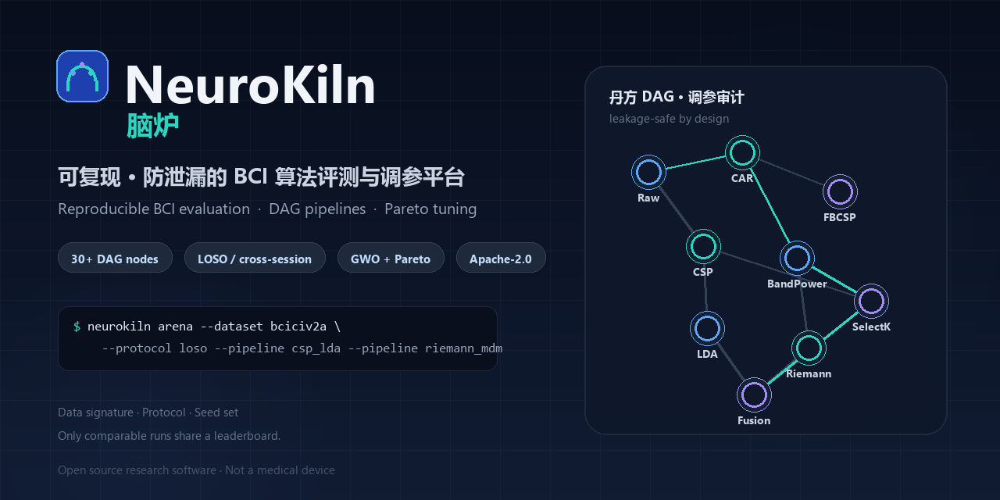
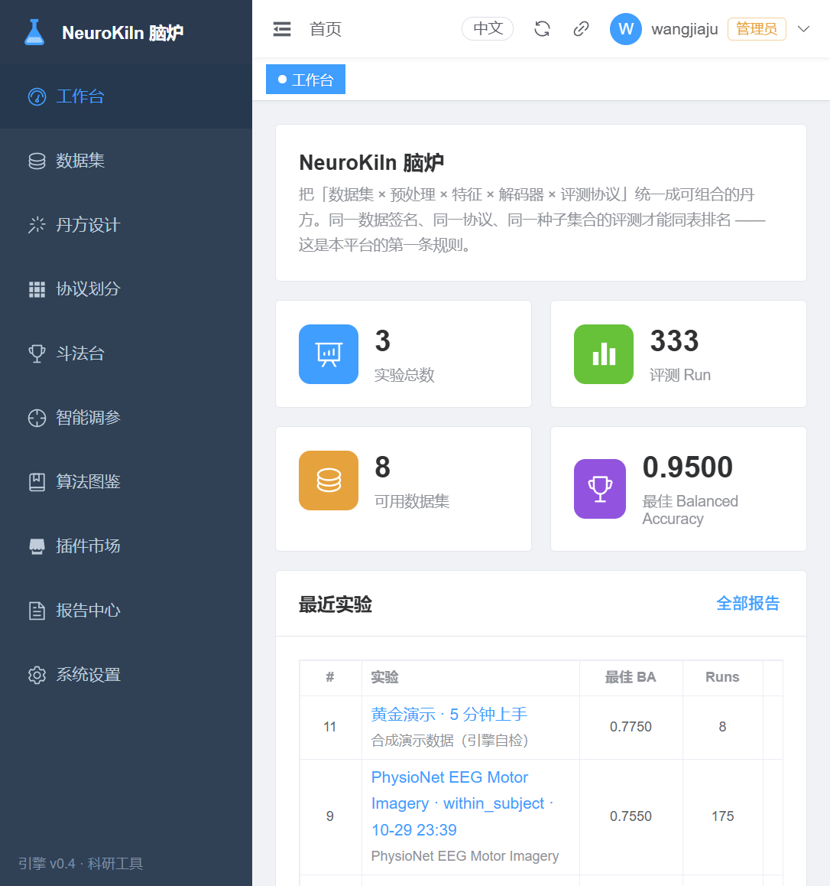
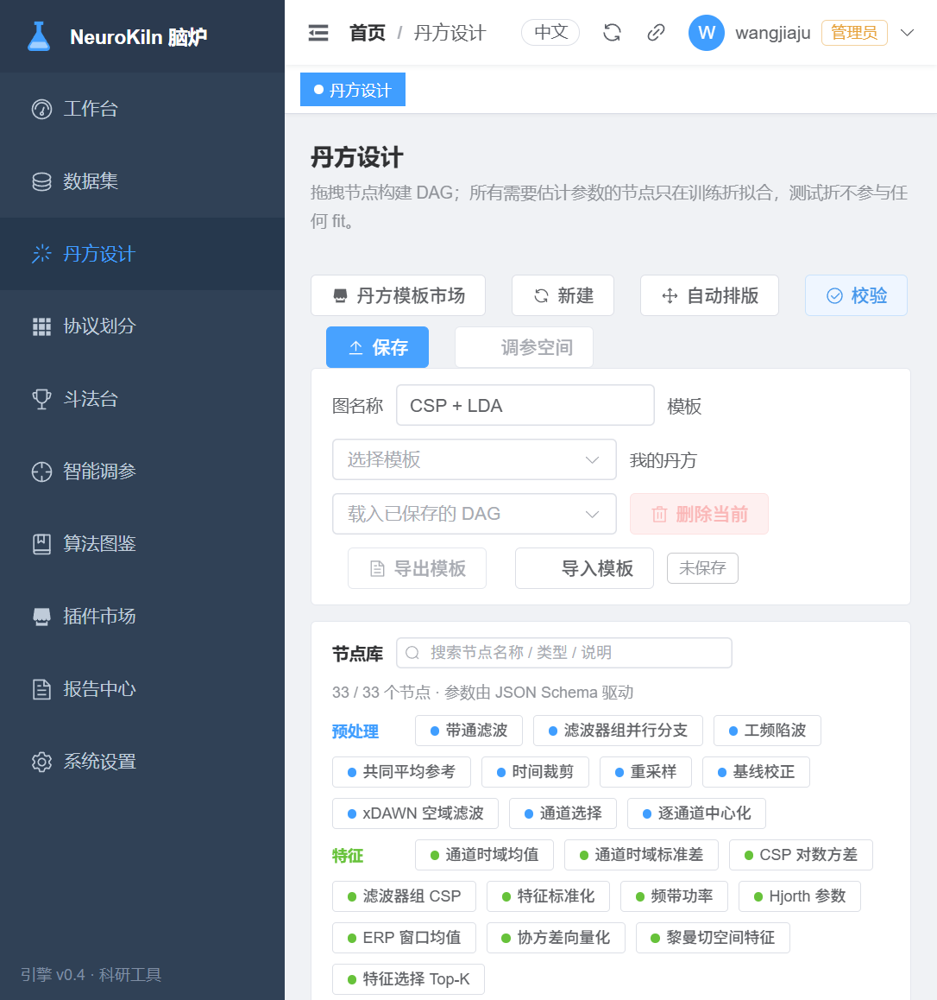
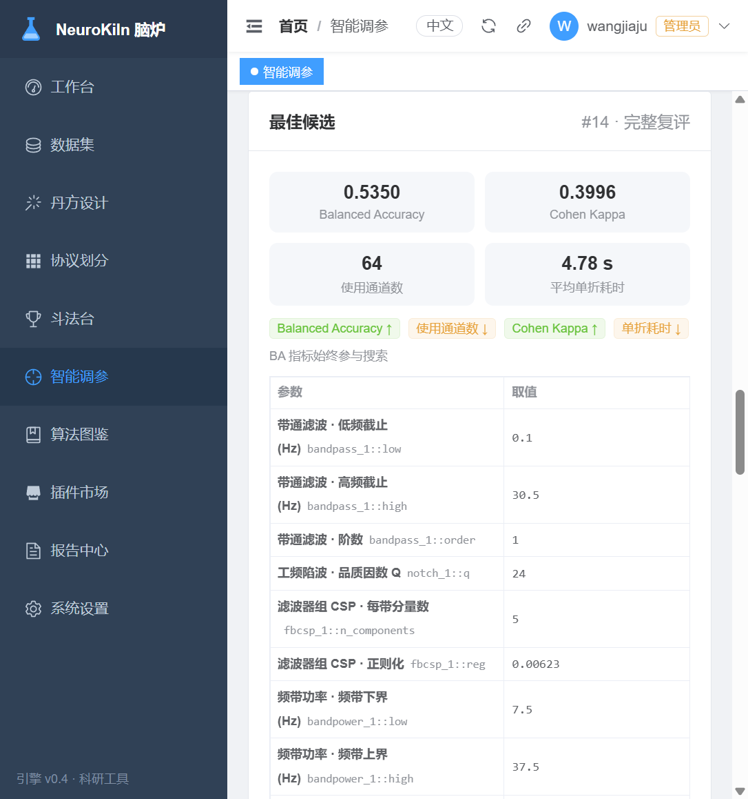
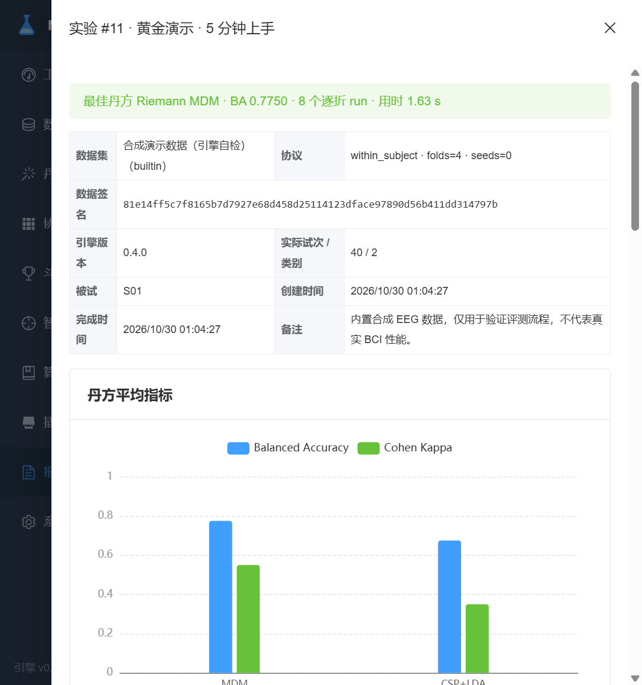
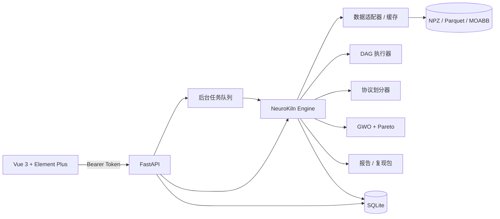

<p align="center">
  
</p>

<p align="center">
  <b>可复现、防泄漏的 BCI 算法评测与调参平台</b><br>
  把数据集、协议划分、丹方（DAG）、指标统计、报告与复现包收敛成一条可审计流水线。
</p>

<p align="center">
  
  
  
  
</p>

<p align="center">
  <a href="https://github.com/JadueW/neurokiln/actions/workflows/ci.yml"></a>
  <a href="https://github.com/JadueW/neurokiln/releases"></a>
  <a href="https://jaduew.github.io/neurokiln/"></a>
</p>

<p align="center">
  <a href="README.en.md">English</a> · <a href="https://jaduew.github.io/neurokiln/">文档站</a> · <a href="docs/user-manual.md">用户手册</a> · <a href="docs/online-closed-loop.md">在线闭环</a> · <a href="docs/security.md">安全模型</a>
</p>

---

## 为什么做 NeuroKiln

BCI 算法研究里最常见的三个坑，靠自觉很难避免：

1. **数据泄漏**：预处理器在全量数据上 fit，CSP 用了测试折，HPO 用测试集挑候选。
2. **结果不可比**：不同脚本、不同划分、不同随机种子，最后却放进同一张表。
3. **复现不了**：论文只写“CSP + LDA”，没写滤波频带、通道、正则、早停和划分细节。

NeuroKiln 用一条强制流水线解决这三件事：

> **同一数据签名 + 同一协议 + 同一种子集合，才允许同表排名。**

平台把每次实验的数据版本、划分、节点参数、环境、指标和产物都写入 SQLite，并支持导出可复现包、按容差重跑比对。

## 核心能力

| 模块 | 能力 |
|---|---|
| 数据集 | 合成 MI / P300 / SSVEP、MOABB（BCI IV 2a/2b、PhysioNet MI、P300、SSVEP）、本地 NPZ；导入向导支持 NPZ / CSV / EDF / FIF，记录哈希与数据签名 |
| 评测协议 | 被试内重复分层 K 折、跨 session、留一被试（LOSO）；预处理只在训练折 fit |
| 丹方 | 30+ 节点的有向无环图（预处理 / 特征 / 解码器 / 融合），支持命名端口与滤波器组并行 |
| 调参 | 灰狼优化 + 精英局部搜索 + Pareto 存档；代理折筛选后完整协议复评；支持自定义搜索空间 |
| 统计 | 平衡准确率、Cohen's Kappa、被试级 bootstrap CI、配对检验、概率校准 |
| 可解释性 | 内在参数 topomap、通道×时间遮挡、频带消融、Captum 梯度、faithfulness / 稳定性与知识闭包审计 |
| 报告 | HTML / Excel，一键导出可复现包；论文级 Word / LaTeX / GB/T 7714 导出 |
| 模板与复现 | 可移植 DAG 模板市场、论文复现目录、一键载入画布；插件清单 v2 与引擎版本兼容检查 |
| 在线扩展 | 传输无关的流式数据源、在线解码器、置信度阈值策略与留出折回放 CLI |
| 部署 | 单机 SQLite、Docker Compose、本地账号与 Bearer Token；中英文界面切换 |

## 快速开始

### Docker（推荐）

```bash
# 拉取已发布镜像（linux/amd64、linux/arm64）
docker pull ghcr.io/jaduew/neurokiln:0.4.0
docker run -d --name neurokiln -p 127.0.0.1:8100:8100 \
  -e NEUROKILN_DATA_DIR=/data -v neurokiln-data:/data \
  ghcr.io/jaduew/neurokiln:0.4.0
```

或在仓库根目录自行构建：

```bash
docker compose up -d --build
```

打开 <http://127.0.0.1:8100>，首次启动创建本机管理员账号（至少 8 位密码）。

数据、数据库、插件与登录密钥保存在 Docker volume `neurokiln-data` 中。升级镜像不会丢实验结果。

### 本地开发

需要 Python 3.10+（推荐 3.12）与 Node.js 20+。

```bash
python -m venv .venv
# Windows
.venv\Scripts\activate
# macOS / Linux
source .venv/bin/activate

pip install -e "./engine[datasets]"
pip install -r server/requirements.txt

# 可选：torch 解码器的 Captum 梯度归因
pip install -e "./engine[xai]"

cd web
npm ci
npm run build
cd ..

uvicorn app.main:app --app-dir server --host 127.0.0.1 --port 8100
```

打开 <http://127.0.0.1:8100>。API 文档在 `/docs`。

前端热更新开发：

```bash
cd web
npm run dev   # http://127.0.0.1:5174，代理到 8100
```

### 五分钟跑通第一个实验

1. 登录后进入「工作台」，点击「五分钟上手」。
2. 选择内置合成数据与 CSP + LDA 丹方，直接运行。
3. 在「报告中心」查看平衡准确率、Kappa、混淆矩阵与逐折明细。
4. 点击「生成分享卡片」，得到带二维码的结果图；二维码默认指向只读 `/demo/index.html`。
5. 想用自己的数据时，进入「数据集 → 接入私有数据」，按向导完成通道、事件与分段映射。
6. 在「丹方设计 → 模板市场 / 论文复现」中载入可移植模板或论文复现配置。

MOABB 数据集首次使用时会自动下载，需要网络与磁盘空间；数据不随仓库分发。

## 界面

<p align="center">
  
  
</p>
<p align="center">
  
  
</p>

## 架构



- `engine/`：与 GUI 无关的评测内核，可独立用 CLI 调用。
- `server/`：FastAPI、账号、后台任务、报告导出。
- `web/`：Vue 3 控制台。
- `docs/`：用户手册与文档站。

## 命令行

```bash
# 列出数据集
neurokiln list-datasets

# 跑两条基线并输出 JSON
neurokiln arena \
  --dataset synthetic --protocol within_subject --folds 2 \
  --pipeline raw_centroid --pipeline var_centroid \
  --no-save --no-cache --json

# 导出实验报告与复现包
neurokiln report --experiment 1 --out report.html --bundle bundle/
neurokiln reproduce 1 --tolerance 0.02

# 用留出折回放逐试次预测与闭环动作（在线扩展点）
neurokiln online-replay --dataset synthetic --pipeline csp_lda \
  --protocol within_subject --folds 4 --fold 0 --threshold 0.6 --json
```

在线扩展只提供数据源 / 解码器 / 决策策略协议与离线回放，不含实时设备驱动；详见 [在线与闭环扩展](docs/online-closed-loop.md)。

## 评测协议与防泄漏约束

- **within_subject**：试次级分层 K 折，可重复多次并使用独立种子。
- **cross_session**：按有序 session 对划分，训练集与测试集不共享时间信息。
- **loso**：留一被试，测试被试的任何试次都不参与 fit、对齐或特征选择。
- 预处理、CSP、特征选择、HPO 候选筛选全部嵌套在训练折内。
- 同一排行榜只接受同一数据签名、同一协议、同一种子集合的结果。

## 智能调参

- 搜索器：灰狼优化 + 精英局部搜索，维护 Pareto 存档。
- 两阶段评估：先用代理折快速筛选，再对候选做完整协议复评。
- 审计：每次评估的向量、参数、阶段、失败原因都写入历史。
- 自定义模板：保存的丹方加 1–16 个显式搜索维度，即可变成 `custom:<id>` 模板。
- 搜索空间护栏：频带上下界、Nyquist 上限、CSP 分量数与正则约束会在提交前校验。

## 模型透视（可解释性）

「模型透视」对单被试、单折的已拟合模型做 P0–P3 分析，所有参考信号都来自训练折：

- **内在参数**：CSP patterns、xDAWN 滤波器、MDM 通道方差比、EEGNet / ShallowConvNet 空间卷积核，渲染为 10-10 topomap；
- **遮挡归因**：按通道组 × 时间窗把输入替换为训练折均值，记录 log-odds 下降；
- **频带消融**：逐频带移除，量化 4–8 / 8–13 / 13–20 / 20–30 / 30–45 Hz 的通道贡献；
- **梯度归因**：对 torch 解码器调用 Captum Integrated Gradients / DeepLIFT（可选依赖）；
- **忠实性与稳定性**：删除 / 插入 / 随机删除曲线、AOPC、半折 Spearman 稳定性；
- **知识审计**：用频带能量 + Hjorth 特征的透明学生模型计算 closure ratio，检查性能能否由既有特征解释。

结果写入 `data/explanations/<job>/`（`global.json`、topomap PNG、逐试次归因），报告中心会自动加入「模型在看哪里」章节。

## 插件与安全模型

- 插件清单 v2 声明 `engine_min_version`、入口、参数与文件哈希。
- 默认只做校验与展示，不执行插件代码。
- 设置 `NEUROKILN_PLUGIN_TRUST=1` 后，插件在当前 Python 进程中执行，**没有沙箱**。
- 只安装你完全信任的插件；生产环境建议保持默认关闭。

更多安全说明见 [SECURITY.md](SECURITY.md)。

## 路线图

- [x] 协议优先的评测内核与防泄漏测试
- [x] 30+ 节点 DAG、融合与命名端口
- [x] 灰狼调参、Pareto 审计、自定义搜索空间
- [x] 插件清单 v2 与 CLI 校验
- [x] Docker、五分钟上手、分享卡片、论文级导出
- [x] 模板市场、论文复现目录与插件版本兼容
- [x] 在线 / 闭环 BCI 扩展点与留出折回放
- [x] P0–P3 可解释性：内在参数、遮挡 / 频带归因、Captum 梯度与知识审计
- [ ] 多用户协作与远程计算后端

## 参与贡献

欢迎 Issue、数据集适配器、节点、模板与文档贡献。开始之前请阅读 [CONTRIBUTING.md](CONTRIBUTING.md)。

```bash
# 本地全量检查
bash scripts/ci.sh
```

## 引用

如果 NeuroKiln 对你的研究有帮助，请使用 [CITATION.cff](CITATION.cff) 中的条目。正式 DOI 会在首个 GitHub Release 后通过 Zenodo 生成。

## 许可证

[Apache-2.0](LICENSE)。第三方依赖保持各自许可证。

## 免责声明

NeuroKiln 是科研工具，不是医疗器械。所有分数只代表离线数据集上的算法表现，不代表在线、临床或个体化诊断可用性。请勿用于诊断、治疗或任何医疗宣称。使用 MOABB 或其他公开数据集时，请遵守其原始许可证与引用要求。
